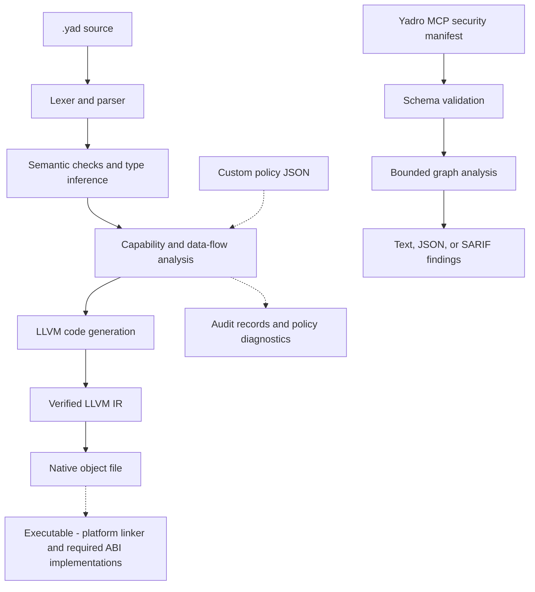

# YadroLang English

[](https://github.com/vadesxl/YadroLang-English/actions/workflows/run.yml)
[](https://github.com/vadesxl/YadroLang-English/releases/latest)

**An LLVM compiler and static policy analyzer for YadroLang source and Yadro MCP tool graphs.**

YadroLang English compiles `.yad` programs to verified LLVM IR and native object files. Its compiler checks declared capabilities and tracks sensitive data through expressions, function calls, branches, and loops. A separate scanner analyzes the project's versioned MCP security manifest.

The latest public release is [v2.1.0](https://github.com/vadesxl/YadroLang-English/releases/tag/v2.1.0). The language and analysis model are experimental and have a documented scope. Policy findings describe violations of explicit rules; they do not establish general AI ethicality or regulatory compliance.

This README describes the public code reviewed at [`5270bbb`](https://github.com/vadesxl/YadroLang-English/commit/5270bbb1914e616c98214b59df0c6954098629b4) from 10 November 2026. That code includes changes after the July v2.1.0 release; the package version alone does not identify the same source snapshot.

## Implemented capabilities

- Functions, local variables, assignment, recursion, `if/else`, and `while`.
- Inferred `i64` and `bool` types, plus direct string printing through `printf`.
- Verified LLVM IR, generated native entry point, and object emission for the local target.
- Capability mandates declared with `requires [...]` and checked through calls.
- Interprocedural tracking of `PII`, `Financial`, `Health`, `Credentials`, and `Location` labels, including control-flow dependencies and label-specific declassification.
- Source scan, compile, audit, and custom-policy validation commands, with text, JSON, and SARIF diagnostics.
- Bounded static analysis of Yadro MCP tool graphs for sensitive flows and excessive-capability heuristics.

See [Feature status](FEATURE_STATUS.md), [Type system](TYPE_SYSTEM.md), and [Architecture](ARCHITECTURE.md) for the supported surface and remaining work.

## Compiler and policy paths



The compiler's default output is an object file, not a linked executable. Calls to external system APIs use the documented [ABI](ABI.md); their implementations and sanitizer behavior are deployment assumptions.

## Quickstart

Use Python 3.11 and the pinned dependency in `requirements.txt`. Run these commands from a terminal:

```bash
git clone https://github.com/vadesxl/YadroLang-English.git
cd YadroLang-English
python -m pip install -r requirements.txt

# Print verified LLVM IR.
python -m src.main examples/test.yad --ir

# Emit kernel.o for the local target.
python -m src.main examples/test.yad
```

On Windows, native object emission requires a supported LLVM/clang toolchain in `PATH`. Printing IR does not require that object-emission step. Linking and executing an object require the platform toolchain and any external ABI implementations used by the program.

### A complete program

Save this as `hello.yad` and compile it with `python -m src.main hello.yad --ir`:

```text
fn double(x) {
    return x * 2
}

fn main() {
    print("Hello, YadroLang!")
    print(double(21))
    return 0
}
```

The snippet declares every function it calls except the built-in `print`. It uses the language's inferred parameter types and newline-separated statements.

## Source analysis CLI

The module entry point can be used after installing the requirements:

```bash
python -m src.guard_cli version
python -m src.guard_cli scan examples/test.yad
python -m src.guard_cli scan examples/leak.yad --format json
python -m src.guard_cli audit examples/safe.yad --format json
python -m src.guard_cli policy check policies/example.json
python -m src.guard_cli compile examples/test.yad -o kernel.o
```

The leak fixture is intended to produce a policy violation and exit code `2`. The safe fixture illustrates the analyzer's declared sanitizer model; it does not demonstrate a deployed sanitizer implementation.

Custom policies extend the built-in source, sink, and sanitizer roles for one invocation:

```bash
python -m src.guard_cli scan examples/test.yad --policy policies/example.json --format sarif
```

For installed console commands, run `python -m pip install -e .`. This provides `yadro-guard` and `yadro-guard-mcp`.

CLI exit codes are `0` for success, `2` for a policy violation, `3` for an input or source error, and `4` for an internal failure. See [Policy specification](POLICY_SPEC.md) and [Diagnostics](DIAGNOSTICS.md).

## MCP tool-graph analysis

The scanner accepts the [Yadro MCP security manifest v1.0](MCP_SCHEMA.md). Tools declare output labels, sanitizers, and capabilities; explicit flow edges describe how data moves between tools. The scanner computes a bounded label fixpoint and reports sensitive data reaching privileged tools, plus excessive-capability heuristics.

For a manifest you have prepared in that schema, run:

```bash
python -m src.guard_cli mcp scan path/to/yadro-manifest.json --format json
```

This is static analysis of declared graph metadata. It does not import every vendor's MCP configuration, observe live tool behavior, or replace runtime authorization.

## Reviewed flow and return checks

The preserved return-path fixes are now applied in `main`: helpers must return on every path, and this check runs before LLVM backend creation. The entry function retains its documented implicit zero return.

The existing control-flow patches 1-6 now also join branch exits in helper leak summaries and converge return, parameter-leak, and caller-PC summaries together. Sensitive numeric results of `main()` are rejected before LLVM IR because the native wrapper prints them after the source body. This closes an output path not represented by a source-level `print` call.

See [reviewed-flow-fixes.md](docs/analysis/reviewed-flow-fixes.md) for behavioral regressions and analysis limits. These are subsequent `main` changes; the existing v2.1.0 release tag remains an earlier source snapshot.

## Proof Seal development

[Yadro Proof Seal](PROOF_SEAL.md) is a staged evidence format intended to connect a versioned policy contract to LLVM and native artifacts. Consult [Implementation status](PROOF_SEAL_IMPLEMENTATION.md) for the phase inventory and integration work.

It is separate from the released compiler/scan commands described above. This README does not claim an integrated seal-generation CLI, complete evidence coverage, or authenticated attestation. An unsigned self-digest can check consistency but cannot establish authenticity or resist coordinated replacement of all inputs. External implementation assumptions remain part of the contract.

[Proof Seal positioning](PROOF_SEAL_MARKET.md) records a dated engineering comparison; it is not an exhaustive market survey, patent search, or vendor certification.

## Scope and limitations

The [Threat model](THREAT_MODEL.md) and [Feature status](FEATURE_STATUS.md) define the boundaries of the analysis:

- Sanitizer semantics and external ABI implementations require independent assurance.
- Runtime compromise, malicious toolchains, and microarchitectural side channels are outside the stated analysis scope.
- Dynamic `i64` overflow is not comprehensively trapped.
- Arbitrary string storage and return, a full memory ownership model, and a general-purpose runtime ABI library are not part of the documented language surface.
- MCP excessive-agency findings are heuristics over the declared Yadro graph.
- Audit output supports inspection of policy decisions; it is not a compliance certificate or a whole-program formal proof.

## Development and review

This repository is the English-language counterpart of the [Russian YadroLang project](https://github.com/vadesxl/YadroLang). The frontends share a declared semantic surface, with localized syntax and messages. [Semantic parity](SEMANTIC_PARITY.md) documents checks against pinned counterpart snapshots and the limits of those checks.

Development uses AI assistance. The public code, fixtures, specifications, and CI history are the basis for evaluating implementation claims.

See [Contributing](CONTRIBUTING.md), [Security reporting](SECURITY.md), and the [v2.1.0 changelog](CHANGELOG.md) for contribution guidance and release details.

## License

GPL-3.0-only, as declared in the [package metadata](pyproject.toml). The full license text is in [LICENSE](LICENSE).
